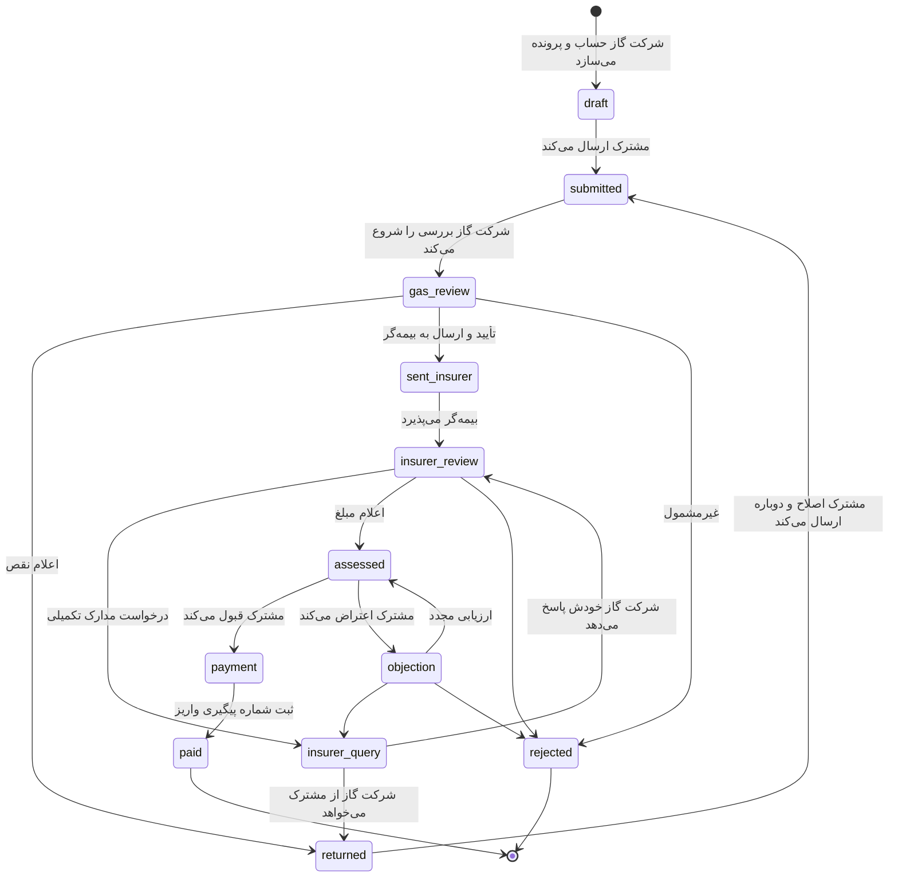

# طراحی سامانه بیمه حوادث مشترکین گاز

این سند نیازها، گردش کار، قواعد، موارد خاص و معماری پیشنهادی نسخه عملیاتی را شرح می‌دهد.
نسخه فعلی مخزن یک **نمونه اولیه کامل و قابل کلیک** است و همه منطق آن در مرورگر اجرا می‌شود (بخش ۱۰).

---

## ۱. هدف

مشترکی که دچار حادثه گاز (آتش‌سوزی، انفجار، گازگرفتگی) شده، به‌جای رفت‌وآمد حضوری و تحویل کاغذی مدارک:

1. یک بار به شرکت گاز مراجعه می‌کند و حساب کاربری می‌گیرد.
2. همه اطلاعات، عکس‌ها و مدارک را خودش در سامانه بارگذاری و ارسال می‌کند.
3. شرکت گاز بررسی می‌کند، نقص‌ها را دقیق و مورد به مورد اعلام می‌کند و پس از تکمیل، پرونده را برای بیمه‌گر می‌فرستد.
4. بیمه‌گر ارزیابی، مبلغ را اعلام و پس از تأیید مشترک پرداخت می‌کند.
5. همه طرف‌ها در هر لحظه وضعیت، مهلت و تاریخچه پرونده را می‌بینند.

## ۲. نقش‌ها و دسترسی‌ها

| کار | مشترک | کارشناس شرکت گاز | کارشناس بیمه‌گر | مدیر |
|---|:-:|:-:|:-:|:-:|
| ساخت حساب مشترک و تشکیل پرونده | | ✓ | | |
| صدور رمز موقت جدید | | ✓ (مشترکین) | | ✓ (همه) |
| تکمیل اطلاعات حادثه، خسارت، عکس، مدارک، شبا | ✓ (فقط در پیش‌نویس یا نقص) | | | |
| ارسال پرونده | ✓ | | | |
| بررسی گزارش علت حادثه و تأیید قید «گاز» در آن | | ✓ | | |
| اعلام نقص (مدرک به مدرک یا بخش به بخش) | | ✓ | ✓ (به‌صورت استعلام) | |
| ارسال به بیمه‌گر / رد پرونده | | ✓ | | |
| ارزیابی، اعلام مبلغ، رد، ثبت پرداخت | | | ✓ | |
| قبول مبلغ یا اعتراض | ✓ | | | |
| پیام در پرونده | ✓ | ✓ | ✓ | ✓ |
| یادداشت داخلی (مشترک نمی‌بیند) | | ✓ | ✓ | ✓ |
| تنظیم سقف‌ها، فرانشیز و مهلت‌ها | | | | ✓ |
| کاربران کارکنان، گزارش‌ها، گزارش پیامک | | | | ✓ |

بیمه‌گر فقط پرونده‌هایی را می‌بیند که دست‌کم یک بار از شرکت گاز برایش ارسال شده است.

## ۳. گردش کار



قواعد انتقال در `js/workflow.js` (ثابت `ACTIONS`) تعریف شده و تست دارد. هر انتقال:
نقش مجاز، وضعیت‌های مبدأ و شرط لازم را بررسی می‌کند و یک رکورد در تاریخچه می‌نویسد.

### شرط‌های کلیدی

- **ارسال توسط مشترک**: همه بخش‌ها کامل، دست‌کم ۴ عکس، همه مدارک الزامی، شبای معتبر (کنترل mod-97)، تأیید تعهدنامه، و پاسخ به همه نقص‌های باز.
- **اعلام نقص**: دست‌کم یک نقص بدون پاسخ ثبت شده باشد.
- **ارسال به بیمه‌گر**: مدارک مشترک کامل و بدون نقص باز، و تأیید صریح کارشناس گاز که گزارش علت حادثه را دیده و در آن «گاز» به‌عنوان علت قید شده است (نام و زمان تأییدکننده در پرونده ثبت می‌شود). شرکت گاز بازدید از محل ندارد.
- **ارزیابی**: نام ارزیاب و دست‌کم یک ردیف.
- **رد پرونده و اعتراض**: نوشتن دلیل الزامی است.
- **پرداخت**: شماره پیگیری و تاریخ واریز الزامی است. مبلغ از ارزیابی محاسبه می‌شود و قابل دست‌کاری نیست.

### فرایند مالی پس از قبول مبلغ

در وضعیت «در انتظار پرداخت» پرونده این زیرمرحله‌ها را به ترتیب طی می‌کند. ترتیب در `applyFinance` اجباری است و جزئیات هر گام برای مشترک نمایش داده می‌شود:

| گام | جزئیات ثبت‌شده | اطلاع به مشترک |
|---|---|---|
| تأیید مبلغ توسط مشترک | زمان تأیید، مبلغ پذیرفته‌شده | — |
| بررسی مالی و استعلام شبا | بررسی‌کننده، تطبیق شبا با نام ذی‌نفع (الزامی)، توضیح | اعلان |
| صدور حواله پرداخت | شماره حواله، تاریخ صدور، مبلغ حواله، صادرکننده | اعلان و پیامک |
| ارسال دستور پرداخت به بانک | روش (پایا یا ساتنا)، شماره پیگیری، تاریخ، زمان تقریبی واریز | اعلان و پیامک |
| واریز به حساب ذی‌نفع | شماره پیگیری بانکی، تاریخ، مبلغ، حساب مقصد (پوشیده) | اعلان، پیامک و رسید قابل رونوشت |

مشترک خلاصه مالی (خسارت نهایی، پرداخت‌شده، مانده) و همه این جزئیات را در «پیگیری پرونده» می‌بیند.

### بازیابی رمز عبور

1. کاربر در صفحه ورود «رمز عبور را فراموش کرده‌ام» را می‌زند و نام کاربری و موبایل ثبت‌شده را وارد می‌کند.
2. اگر هر دو با یک حساب فعال بخواند، کد ۶ رقمی پیامک می‌شود. پیام صفحه برای حساب موجود و ناموجود یکسان است تا وجود حساب لو نرود.
3. کد فقط به‌صورت هش نگه داشته می‌شود، ۲ دقیقه اعتبار دارد، حداکثر ۵ بار قابل امتحان است و ارسال دوباره پس از یک دقیقه فعال می‌شود.
4. پس از تأیید کد، رمز تازه ثبت و پیامک «رمز شما تغییر کرد» فرستاده می‌شود.

کاربری که موبایل ثبت‌شده ندارد یا موبایلش عوض شده، از شرکت گاز یا مدیر سامانه رمز موقت می‌گیرد. در نسخه عملیاتی تولید و بررسی کد باید در سرور انجام شود و برای هر شماره و هر IP سقف درخواست گذاشته شود.

### گزارش‌ها و داشبورد لحظه‌ای
در دسترس شرکت گاز، بیمه‌گر و مدیر (دکمه «گزارش» در نوار پایین). بیمه‌گر فقط پرونده‌های ارجاع‌شده به خودش را می‌بیند.

- **وضعیت لحظه‌ای:** کل پرونده‌ها، ارجاع‌شده به بیمه (تجمعی)، در دست بررسی بیمه و پرداخت‌شده؛ و هشت گروه وضعیت (نزد مشترک، بررسی شرکت گاز، ارجاع به بیمه، در دست بررسی بیمه، تعیین خسارت، در انتظار پرداخت، پرداخت‌شده، رد شده) با تعداد و درصد. هر وضعیت دقیقاً در یک گروه است. صفحه هر ۱۵ ثانیه از سرور تازه می‌شود.
- **حوادث به تفکیک ماه و نوع:** جدول ۱۲ ماه × آتش‌سوزی، انفجار، مسمومیت و سایر (نشت گاز) برای سال انتخابی؛ ملاک، تاریخ وقوع حادثه است (اگر وارد نشده باشد، تاریخ تشکیل پرونده). با زدن هر خانه، فهرست همان پرونده‌ها می‌آید.
- **خروجی‌ها:** Excel وضعیت لحظه‌ای (خلاصه + فهرست پرونده‌ها)، Excel جدول ماهانه، Excel با ۳۳ ستون جزئیات برای هر انتخاب، گزارش چاپی انتخاب، و «گزارش کامل پرونده» (مشترک، حادثه، گزارش علت، خسارت، مدارک، نقص‌ها، ارزیابی، مراحل مالی، تاریخچه) با چاپ/PDF یا دانلود فایل HTML. خروجی‌ها اطلاعات هویتی و بانکی دارند و باید محرمانه بمانند.

### بیمه آتش‌سوزی در صفحه ورود
دکمه «خرید بیمه آتش‌سوزی منزل» در صفحه ورود اپ و سایت، سه طرح (پایه، متوسط، جامع) با نام بیمه‌گر، نرخ و پوشش نشان می‌دهد و هر طرح به سایت همان بیمه‌گر می‌رود. مدیر هر سه طرح را در «تنظیمات» وارد می‌کند؛ نشانی فقط با https پذیرفته می‌شود (در مرورگر و روی سرور). مقادیر پیش‌فرض نمونه‌اند.

## ۴. مهلت‌ها (SLA)

| وضعیت | اقدام با | مهلت پیش‌فرض |
|---|---|---|
| ارسال‌شده / بررسی گاز / استعلام بیمه‌گر | شرکت گاز | ۷ روز |
| نزد بیمه‌گر / ارزیابی / اعتراض / پرداخت | بیمه‌گر | ۱۵ روز |
| نقص پرونده | مشترک | ۱۰ روز |
| اعلام حادثه پس از وقوع | مشترک | ۳۰ روز (اعلام دیرتر ثبت و علامت‌گذاری می‌شود) |

مهلت‌ها در تنظیمات مدیر قابل تغییرند. روی هر پرونده «روز مانده» یا «روز تأخیر» نمایش داده می‌شود.

## ۵. مدارک

فهرست مدارک بر اساس نوع حادثه و نوع خسارت **خودکار** ساخته می‌شود:

| مدرک | چه زمانی لازم است |
|---|---|
| کارت ملی، سند/اجاره‌نامه، قبض گاز، گواهی شبا | همیشه |
| **گزارش آتش‌نشانی یا کارشناس رسمی دادگستری با قید صریح علت «گاز»** | همیشه (مهم‌ترین مدرک) |
| فاکتور یا برآورد اقلام | خسارت مالی |
| گزارش کلانتری | جرح یا فوت (در غیر این صورت اختیاری) |
| پرونده پزشکی و صورت‌حساب | هزینه درمان |
| گواهی پزشکی قانونی | جرح یا فوت |
| گواهی فوت، انحصار وراثت و مدارک وراث | فوت |

عکس‌ها پیش از ذخیره به حداکثر ۱۶۰۰ پیکسل فشرده می‌شوند. PDF تا ۱۵ مگابایت پذیرفته می‌شود.

### گزارش علت حادثه

چون شرکت گاز بازدید از محل ندارد، تنها سند اثبات اینکه حادثه از گاز بوده، **گزارش آتش‌نشانی یا کارشناس رسمی دادگستری** است:

- برای همه انواع حادثه الزامی است.
- مشترک در بخش «اطلاعات حادثه» صادرکننده، شماره و تاریخ گزارش را وارد می‌کند و تأیید می‌کند که در گزارش صریحاً علت «گاز» قید شده است؛ بدون این موارد پرونده ارسال نمی‌شود.
- کنار مدرک، راهنما نمایش داده می‌شود: علت باید روشن «گاز» باشد؛ گزارش با علت نامعلوم یا غیر از گاز (مثلاً اتصالی برق) پذیرفته نمی‌شود؛ مهر و امضا، تاریخ و نشانی لازم است.
- کارشناس گاز هنگام «ارسال به بیمه‌گر» باید تأیید کند که گزارش را دیده و علت گاز در آن قید شده است؛ سرور بدون این تأیید ارسال را نمی‌پذیرد.

## ۶. محاسبه خسارت

```
خسارت مالی خالص = min(جمع تأییدشده مالی − فرانشیز٪ , سقف مالی)
درمان           = min(جمع تأییدشده درمان , سقف درمان)
فوت             = min(جمع تأییدشده فوت , سقف فوت × تعداد متوفیان)
قابل پرداخت     = مجموع سه بند بالا
```

سقف‌ها و فرانشیز پیش‌فرض **نمونه‌اند**. مدیر باید آنها را مطابق بیمه‌نامه سال جاری وارد کند.

## ۷. موارد خاص پیش‌بینی‌شده

| موقعیت | رفتار سامانه |
|---|---|
| مشترک قبلاً حساب داشته | با کد ملی یا شماره اشتراک پیدا می‌شود و فقط پرونده جدید می‌گیرد؛ رمز تغییر نمی‌کند. |
| شماره اشتراک با کد ملی دیگری ثبت شده | ثبت متوقف و خطا نمایش داده می‌شود. |
| چند پرونده برای یک مشترک | برگه «پرونده‌ها» برای انتخاب پرونده (مثل انتخاب قرارداد در نمونه). |
| ورود اول با رمز موقت | تغییر رمز اجباری؛ رمز جدید نباید همان رمز موقت باشد. |
| فراموشی رمز | شرکت گاز یا مدیر رمز موقت جدید صادر و پیامک می‌کند. |
| گزارش علت حادثه مبهم است یا علت را غیر از گاز نوشته | کارشناس گاز روی همان مدرک «اعلام نقص» می‌زند؛ اگر علت قطعاً غیر از گاز است، پرونده را با دلیل رد می‌کند. |
| اعلام دیرهنگام حادثه | در تاریخچه و خلاصه پرونده علامت‌گذاری می‌شود. |
| پاسخ ناکافی مشترک به نقص | «پاسخ کافی نیست» پاسخ را پاک و یادداشت را حفظ می‌کند تا دوباره برگردد. |
| بیمه‌گر مدرک بیشتری بخواهد | استعلام به شرکت گاز می‌رود؛ گاز خودش پاسخ می‌دهد یا به مشترک ارجاع می‌دهد. |
| اعتراض به مبلغ | دلیل الزامی؛ بیمه‌گر ارزیابی را اصلاح یا استعلام یا رد می‌کند. |
| فوت مشترک | بخش متوفیان و مدارک وراث؛ شبا باید به نام ذی‌نفع قانونی باشد. |
| مستأجر بودن مشترک | اجاره‌نامه به‌جای سند پذیرفته می‌شود. |
| حساب غیرفعال | ورود ممکن نیست؛ پیام راهنما نمایش داده می‌شود. |
| یادداشت‌های حساس | یادداشت داخلی گاز و بیمه‌گر برای مشترک نمایش داده نمی‌شود. |

## ۸. اعلان‌ها

| رویداد | گیرنده | پیامک |
|---|---|:-:|
| تشکیل پرونده (نام کاربری و رمز موقت) | مشترک | ✓ |
| ارسال یا ارسال مجدد پرونده | شرکت گاز | |
| اعلام نقص | مشترک | ✓ |
| ارسال به بیمه‌گر | بیمه‌گر و مشترک | ✓ |
| استعلام بیمه‌گر و پاسخ آن | شرکت گاز / بیمه‌گر | |
| اعلام مبلغ | مشترک | ✓ |
| قبول یا اعتراض | بیمه‌گر | |
| پرداخت (مبلغ و شماره پیگیری) | مشترک | ✓ |
| رد پرونده (با دلیل) | مشترک و طرف دیگر | ✓ |
| پیام جدید | طرف‌های پرونده | |

## ۹. مدل داده (خلاصه)

- **User**: `id, role, username, name, nationalId, subscriptionNo, mobile, address, org, active, mustChangePassword, pwHash`
- **Claim**: `id, code (GZ-سال-شماره), subscriberId, status, statusAt, submitCount, forwardedAt,`
  `incident{date,time,type,placeType,address,postalCode,description,fireReportNo,policeReportNo},`
  `damage{kinds[], items[], injured[], deceased[]}, photos[], docs{docType: fileId[]}, files{id: meta},`
  `bank{sheba,holder,bankName}, declaration, gasReport{…}, assessment{adjuster,visitDate,items[],note},`
  `payment{ref,date,amount}, deficiencies[], messages[], timeline[]`
- **Deficiency**: `target (doc:… | section:… | general), title, note, by (gas|insurer), status (open|closed), reply`
- **Notification / SMS log / Settings**

## ۱۰. محدودیت‌های نسخه فعلی

- داده‌ها در `localStorage` و فایل‌ها در IndexedDB **همان مرورگر** ذخیره می‌شوند؛ بنابراین مشترک و شرکت گاز روی دو دستگاه مختلف پرونده مشترک ندارند. برای استفاده واقعی سرور لازم است.
- پیامک واقعی ارسال نمی‌شود؛ متن پیامک‌ها در «پیامک‌ها»ی مدیر ثبت می‌شود.
- هش رمز در مرورگر انجام می‌شود و جایگزین احراز هویت سمت سرور نیست.
- سقف‌ها و فرانشیز نمونه‌اند.

## ۱۱. معماری پیشنهادی نسخه عملیاتی

- **سرور API** (مثلاً Django REST یا NestJS) با PostgreSQL؛ منطق `workflow.js` عیناً به سرور منتقل و همان تست‌ها اجرا شود. سرور تنها مرجع تغییر وضعیت باشد.
- **احراز هویت**: نام کاربری و رمز + کد یک‌بارمصرف پیامکی؛ قفل پس از تلاش‌های ناموفق؛ نشست با انقضا.
- **کنترل دسترسی** بر اساس نقش و واحد (هر شرکت گاز استانی فقط پرونده‌های خودش).
- **ذخیره فایل** در فضای ذخیره‌سازی شیء (S3 سازگار یا MinIO داخلی)، با پویش بدافزار، بررسی نوع واقعی فایل و لینک‌های موقت.
- **یکپارچه‌سازی‌ها**: سامانه مشترکین شرکت گاز (تطبیق شماره اشتراک و نشانی)، سامانه شاهکار (تطبیق موبایل و کد ملی)، استعلام شبا، درگاه پیامک، و در صورت امکان دریافت الکترونیکی گزارش آتش‌نشانی.
- **ممیزی**: ثبت تغییرناپذیر همه اقدام‌ها با زمان، کاربر و نشانی IP.
- **حریم خصوصی**: رمزنگاری در حال انتقال و ذخیره، دسترسی حداقلی، سیاست نگهداری و امحای مدارک.
- **گزارش‌ها**: خروجی Excel، شاخص زمان هر مرحله، نرخ نقص، پرونده‌های تأخیری به تفکیک واحد.

### پیاده‌سازی وردپرس (انجام‌شده)

افزونه `wordpress/gas-incident-insurance` نخستین نسخه سروری است:

- **داده:** پرونده نوع نوشته خصوصی `gii_claim` با JSON کامل در متا و متاهای قابل جستجو (وضعیت، مشترک، ارسال‌شده به بیمه‌گر). اعلان و گزارش پیامک هم نوع نوشته‌اند. شماره پرونده ترتیبی است.
- **کاربران و نقش‌ها:** `gii_subscriber`، `gii_gas`، `gii_insurer`، `gii_admin`. مدیر وردپرس هم مدیر سامانه است. کاربران سامانه به پیشخوان وردپرس راه ندارند.
- **API:** `/wp-json/gii/v1/` با کوکی وردپرس و nonce. هر مسیر مالکیت پرونده، نقش و وضعیت را بررسی می‌کند. ویرایش فیلدها فقط برای بخش‌هایی پذیرفته می‌شود که آن نقش در آن وضعیت مجاز است. مبلغ حواله و واریز همیشه از ارزیابی ثبت‌شده محاسبه می‌شود، نه از ورودی مرورگر.
- **ورود:** قفل ۱۵ دقیقه‌ای پس از ۵ تلاش ناموفق. حساب غیرفعال نه وارد سامانه می‌شود و نه وارد وردپرس.
- **بازیابی رمز:** کد HMAC‌شده در transient، با سقف ۵ درخواست برای هر IP و ۳ درخواست برای هر شماره در ۱۰ دقیقه.
- **فایل‌ها:** پوشه `uploads/gii-private-<کلید تصادفی>` با `.htaccess`. فقط JPG، PNG، WEBP، GIF و PDF تا ۱۵ مگابایت، با بررسی نوع واقعی فایل. نمایش از راه REST با `nosniff` و CSP محدود.
- **پیامک:** فقط ثبت، کاوه‌نگار یا ملی‌پیامک. وضعیت هر پیامک در فهرست مدیر دیده می‌شود.
- **اپ قابل نصب:** manifest و سرویس‌ورکر از ریشه سایت سرو می‌شوند. سرویس‌ورکر فقط پوسته را نگه می‌دارد و داده‌ها همیشه از سرور خوانده می‌شوند.

## ۱۲. نقشه راه پیشنهادی

1. ~~سرور و پایگاه داده با همین مدل و تست‌های گردش کار.~~ انجام شد (افزونه وردپرس).
2. ورود پیامکی و درگاه پیامک واقعی.
3. چند واحد سازمانی (شرکت‌های گاز استانی) و چند بیمه‌گر یا قرارداد سالانه.
4. ثبت پرونده به نمایندگی از مشترکی که گوشی هوشمند ندارد (بارگذاری توسط کارشناس گاز).
5. امضای الکترونیکی تعهدنامه.
6. داشبورد مدیریتی و خروجی گزارش.
